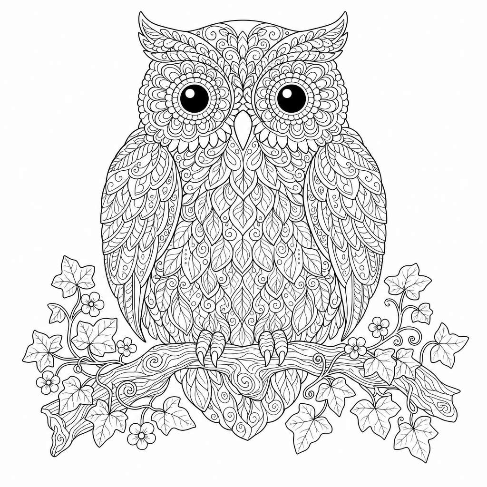
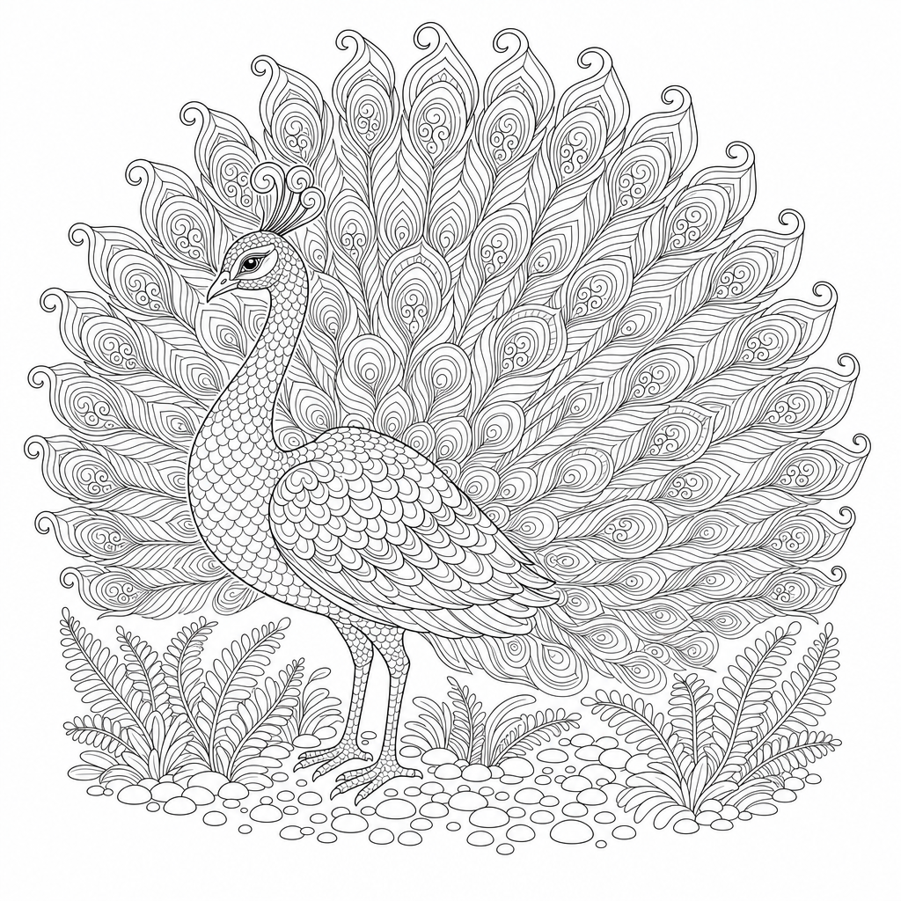
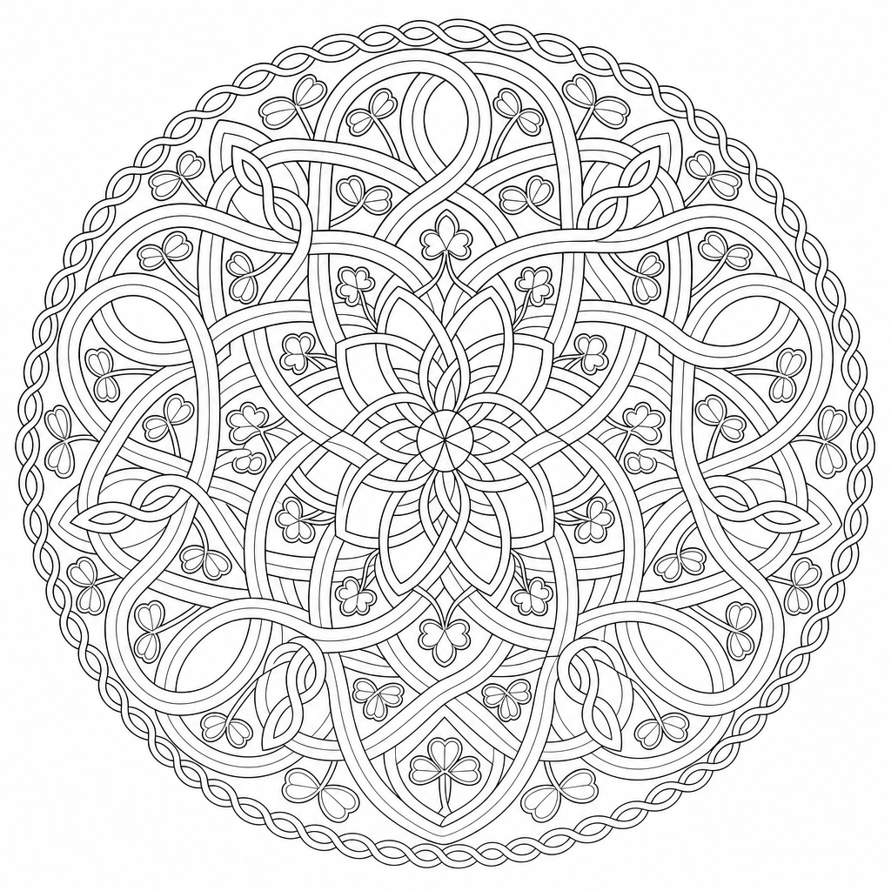
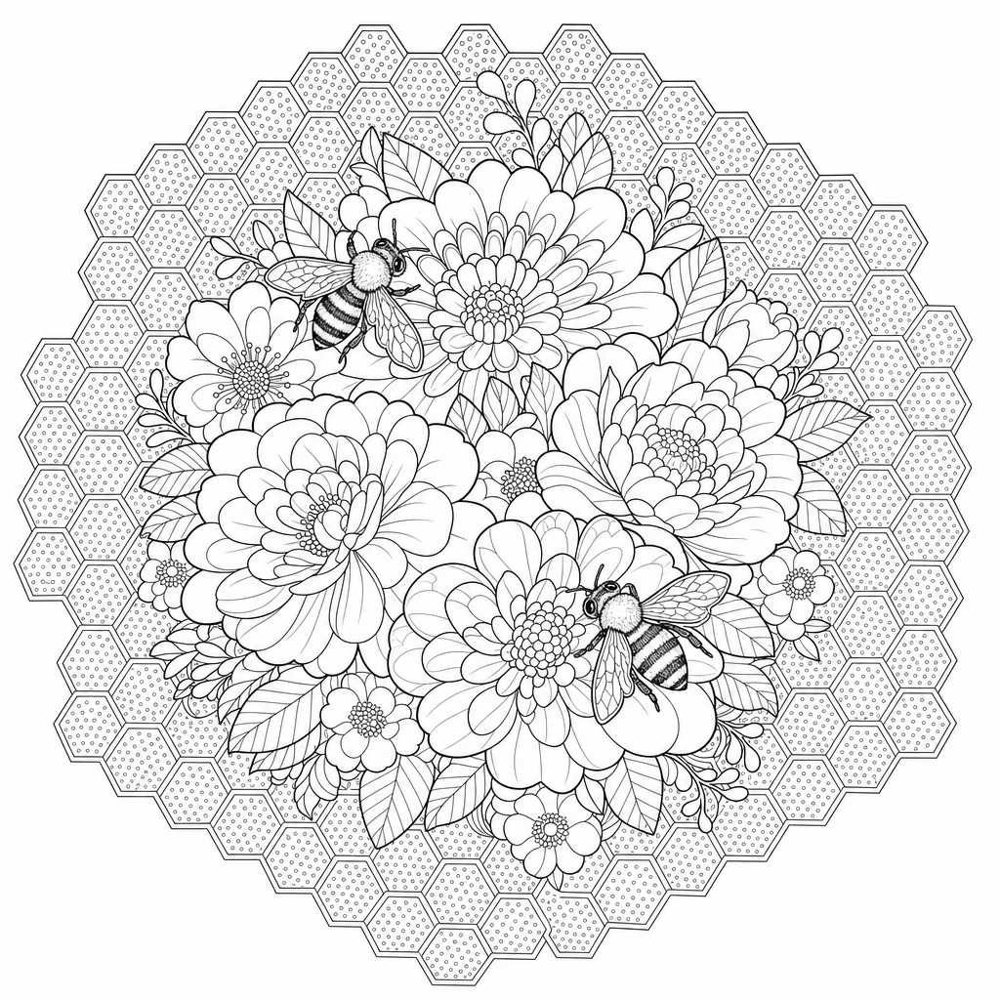

# 🖍️ AI Coloring Book Maker

**Type one sentence and get a print-ready A4 coloring book PDF.**

```bash
python make_book.py "space themed ABC coloring book for my 2-year-old"
python make_book.py "relaxing mandalas and botanicals for adults, 15 pages"
```

This is a Python command-line tool that runs a multi-model AI pipeline. A language model **plans** the book, an image model **draws** every page, a QA layer **checks** each picture with pixel tests and an AI review, and a layout engine **builds** a PDF you can print. It works for toddlers through adults. Every run can be resumed, its costs are under your control, and you can choose the provider (Claude, OpenAI or Gemini).

<p align="center">
  
  
  
</p>
<p align="center">
  
  
</p>
<p align="center"><em>Pages from <a href="books/mandala-nature-patterns/">"Mandala &amp; Nature Patterns"</a>: a 15-page adult book plus a cover, made from one prompt. All 16 pictures passed QA on the first attempt.</em></p>

---

## ✨ Highlights

- **One prompt to a finished PDF.** The tool plans the book, draws the pictures, checks them and lays out the PDF with no manual steps.
- **Self-correcting generation.** When a picture fails QA, its problems are written as instructions and added to the next prompt, so the redraw fixes them. This happens up to `--retries` times, and the best attempt is kept.
- **The same character on every page.** If a book has a recurring character (an astronaut, for example), that character is drawn first. Its picture is then attached as a reference image when drawing the other pages.
- **Two QA layers:**
  - *Pixel checks* cost nothing and run with NumPy. They catch blank images, borders or frames, grey shading or solid black areas, and lines too thin for the age group, measured from the median width of ink runs.
  - *AI review* sends each picture to a vision model, which checks for stray text, illegible micro-detail, a background nobody asked for, or the wrong subject.
- **Age-aware styling.** The `toddler`, `preschool`, `kids` and `adult` presets each set line weight, level of detail and how strict the QA is. Adult mode switches to fine, intricate linework for mandalas and botanicals.
- **Provider-agnostic.** The program talks to every AI service through one small interface, so Claude, Gemini and OpenAI are interchangeable. It picks providers from the API keys it finds.
- **A free offline mode.** `--text mock --images mock` runs the whole pipeline with no API keys, which makes it useful for testing and layout work.
- **Resumable and cost-aware.** You approve the plan before any image is paid for. Finished pictures are never redrawn, so a crash halfway through only costs the missing pages.
- **Print-quality output.** Pictures are cropped, upscaled to 300 DPI and converted to pure black and white. ABC books get hollow outline letters that children can color in, and every page gets a centered caption and a cover.

---

## 🏗️ How it works

```
 "dinosaurs for a 5-year-old"
            │
            ▼
 ┌──────────────────┐   plan.json (title, age, character, one scene per page)
 │ 1. PLAN  (LLM)   │──► validated, saved, shown to you for approval
 └──────────────────┘
            │
            ▼
 ┌──────────────────┐   character page drawn first → used as reference image
 │ 2. DRAW (image)  │   remaining pages drawn in parallel (thread pool)
 └──────────────────┘
            │
            ▼
 ┌──────────────────┐   pixel checks (NumPy) + vision review (LLM)
 │ 3. CHECK (QA)    │──► fail? problems fed back into the prompt → redraw
 └──────────────────┘
            │
            ▼
 ┌──────────────────┐   crop · 300 DPI · pure B/W · hollow letters · captions · cover
 │ 4. BUILD (PDF)   │──► books/<title>/<title>.pdf  +  report.txt
 └──────────────────┘
```

### Design decisions

| Decision | Why |
| --- | --- |
| **The LLM writes only *what* to draw.** Style, framing and the avoid list are fixed in code (`prompts.py`). | Every page of every book gets the same instructions, which keeps the style consistent and stops the prompts from drifting. |
| **QA problems are written as instructions** ("remove the word SPACE at the top"). | They go straight into the retry prompt, so the system corrects itself. |
| **Free pixel checks run before the paid AI review.** | Obvious failures never cost a vision-model call. |
| **The plan is a plain JSON file that a person can edit.** | You can change captions or scenes and then `--resume`, so nothing is a black box. |
| **The PDF builder handles each page on its own.** | One broken picture can't stop the rest of the book from being built, and `report.txt` lists exactly which pages to redo. |
| **Retries with backoff only for temporary errors.** | Rate limits and 5xx errors are retried, while auth and bad-request errors fail at once. |

---

## 🧰 Tech stack

- **Language:** Python 3
- **AI models:** Anthropic Claude (planning and vision QA), OpenAI `gpt-image` (drawing), Google Gemini (any of these roles)
- **Imaging:** Pillow, NumPy (pixel analysis, cleanup, upscaling, black-and-white conversion)
- **PDF:** ReportLab (A4 layout, TrueType fonts, outline text rendering)
- **Other:** `concurrent.futures` for parallel drawing, `python-dotenv` for configuration

About 1,100 lines of Python in six modules:

| Module | Responsibility |
| --- | --- |
| `make_book.py` | Command-line interface and orchestration: plan, then draw, check and build, plus resume and redo logic |
| `planner.py` | Turns the request into a book plan, with schema validation and cleanup |
| `prompts.py` | Age presets and the fixed style template for image prompts |
| `providers.py` | Adapters for Claude, Gemini, OpenAI and the offline mock, plus retry logic |
| `qa.py` | Pixel heuristics and the vision-model review |
| `layout.py` | Image cleanup, font measurement, and the page and cover layout for the PDF |

---

## 🚀 Getting started

```bash
pip install -r requirements.txt
cp .env.example .env          # then add your API keys
```

You need one key for planning and reviewing (`ANTHROPIC_API_KEY` or `GEMINI_API_KEY`) and one for drawing (`OPENAI_API_KEY` or `GEMINI_API_KEY`). A single Gemini key covers both. To choose providers yourself, use `--text` and `--images`.

For the lettering, download **Fredoka** from fonts.google.com and put `Fredoka-Bold.ttf` next to `make_book.py`, or pass `--font`. Without it, the program falls back to Arial Rounded or another bold system font.

### Try it for free first

```bash
python make_book.py "space ABC" --text mock --images mock --yes
```

### Everyday use

```bash
python make_book.py "dinosaurs for a 5-year-old, 12 pages"
python make_book.py "ocean animals ABC" --plan-only          # plan only; edit plan.json, then:
python make_book.py --resume books/ocean-abc
python make_book.py --resume books/ocean-abc --redo q,k      # redraw particular pages
python make_book.py "farm animals" --age toddler --blank-backs
python make_book.py "relaxing mandalas and botanicals for adults, 20 pages"
```

Each book gets its own folder in `books/`:

| File | What it is |
| --- | --- |
| `plan.json` | the plan; edit captions or scenes, then `--resume` |
| `prompts.txt` | the exact prompts, which you can also paste into any image tool by hand |
| `art/` | the final pictures, with every attempt kept in `art/attempts/` |
| `status.json`, `report.txt` | which pictures passed, and what is still wrong with the rest |
| `<name>.pdf` | the finished book |

### Useful options

| Option | Effect |
| --- | --- |
| `--age toddler\|preschool\|kids\|adult` | line weight, detail and how strict QA is (usually worked out from the request) |
| `--pages N` | number of pages in a themed book (ABC books always have 26) |
| `--retries N` | redraws allowed per failed picture (default 2) |
| `--no-review` | skip the AI review and run only the pixel checks |
| `--quality low\|medium\|high` | OpenAI image quality |
| `--workers N` | how many pictures are drawn at once |
| `--blank-backs` | a blank page behind each picture, for double-sided printing |
| `--text-model`, `--image-model` | use a different model name |

### Costs

A 26-page ABC book with a cover needs 27 pictures, plus redraws for any that fail (at most `27 × (1 + retries)`). To spend less, use `--quality medium`, `--retries 1` or `--no-review`. Check your provider's current prices before a big run.

---

## 📚 Example output

[`books/mandala-nature-patterns/`](books/mandala-nature-patterns/) is a complete adult coloring book: *Lotus Mandala, Rose Garden, Owl of Leaves, Starburst Rings, Peacock Plume, Forest Canopy, Seashell Spiral, Butterfly Wings, Celtic Knot, Succulent Array, Moon Phases, Dragonfly Pond, Honeycomb Bloom, Feather Mandala, Desert Bloom*. The folder includes the plan, the prompts, the QA report and the finished PDF.

[`examples/space_abc_plan.json`](examples/space_abc_plan.json) is a full 26-page toddler ABC plan with a recurring astronaut character. You can resume from it or use it as a template.

---

## 🛡️ Content safety

The planner only creates original, wholesome content suited to the age group. If a request names a trademarked character, it invents an original one with a similar feel. If a request isn't suitable for a coloring book, the planner declines it with a reason.
